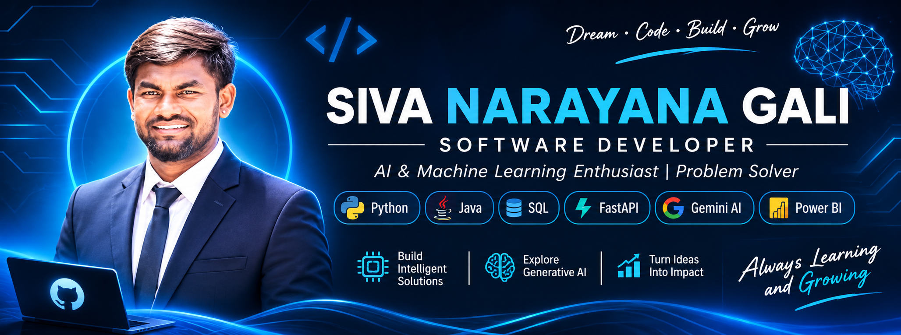

  

<h1 align="center">👋 Hi, I'm Siva Narayana Gali</h1>

<h3 align="center">Software Developer | AI & Machine Learning Enthusiast | Problem Solver</h3>

  

  
  

---

## 🚀 About Me

I am an Electronics and Communication Engineering graduate (2026), passionate about software development, Artificial Intelligence, Generative AI, and data analytics.

I enjoy transforming ideas into practical applications by combining programming, modern technologies, and problem-solving skills.

- 🎓 Electronics and Communication Engineering Graduate – 2026
- 💻 Interested in Software Development and AI Engineering
- 🤖 Exploring Generative AI, RAG, and Multi-Agent Systems
- 🐍 Working with Python and Java programming
- 📊 Interested in Data Analytics and Business Intelligence
- 🌱 Continuously learning new technologies and development practices
- 🎯 Focused on building real-world projects and improving technical skills

---

## 🛠️ Technical Skills

### 💻 Programming Languages

  
  
  

### 🤖 Artificial Intelligence & Generative AI

  
  
  
  
  

### ⚙️ Frameworks, Databases & Tools

  
  
  
  
  
  

### 📊 Data Analytics & Visualization

  
  
  

---

## 💼 Featured Projects

### 1. 🤖 AI AgentOps Platform
**Multi-Agent Intelligence & LLMOps Control Center**

An AI agent management and monitoring platform designed to demonstrate multi-agent workflows, request tracking, and response evaluation.

**Key Features:**
- Developed a backend using Python and FastAPI.
- Implemented General, Coding, and Document-focused agent modules.
- Created automatic query routing to select an appropriate agent.
- Built a Streamlit dashboard for monitoring system activity.
- Integrated SQLite to store request logs and evaluation history.
- Implemented keyword-overlap-based response evaluation.
- Visualized request statistics and agent performance using Plotly.

**Technology Stack:** Python, FastAPI, Streamlit, SQLite, Pandas, Plotly

🔗 **[View AI AgentOps Project](https://github.com/Gali-3/AI-AgentOps-Platform)**

### 2. 🧠 Siva AI – Intelligent Document Assistant
**AI-Powered Retrieval-Augmented Generation Application**

A document-based AI assistant that allows users to upload documents and ask questions about their content.

**Key Features:**
- Developed an interactive document assistant using Streamlit.
- Implemented document processing and retrieval workflows.
- Used LangChain for retrieval-augmented generation.
- Integrated Google Gemini for AI-generated responses.
- Used ChromaDB for document vector storage and retrieval.
- Designed a conversational interface for document-based question answering.

**Technology Stack:** Python, Streamlit, LangChain, Google Gemini AI, ChromaDB

🔗 **[View Siva AI Project](https://github.com/Gali-3/rag-chatbot)**

### 3. 🎯 AI Interview Preparation System
**Interview Question and Answer Evaluation Application**

A Python-based project designed to evaluate candidate answers by comparing them against expected keywords and generating feedback reports.

**Key Features:**
- Implemented keyword-based answer evaluation.
- Compared candidate responses with expected technical keywords.
- Identified missing concepts and skills.
- Calculated answer-matching percentages.
- Generated interview evaluation reports.
- Designed the system to help identify knowledge gaps.

**Technology Stack:** Python, Keyword Matching, Text Processing

🔗 **[View AI Interview Project](https://github.com/Gali-3/ai-interview)**

### 4. 📊 Banking Transaction Analytics Dashboard
**Power BI Dashboard for Banking Transaction Analysis**

An interactive dashboard designed to analyze banking transaction performance and present meaningful business insights.

**Key Features:**
- Analyzed total, completed, and failed transactions.
- Created a Completion Rate measure using DAX.
- Developed KPIs for transaction performance.
- Analyzed transactions by city, account type, date, and transaction type.
- Used interactive visualizations to present transaction trends.
- Designed a dashboard for understanding transaction performance.

**Technology Stack:** Power BI, DAX, Data Analytics, Data Visualization

---

## 📈 GitHub Statistics

  
  

  

---

## 🎯 Current Focus

- Strengthening Java and Python programming fundamentals.
- Improving problem-solving and coding skills.
- Learning backend development with FastAPI.
- Exploring Generative AI and Multi-Agent Systems.
- Understanding RAG architectures and AI application development.
- Improving SQL and database management skills.
- Building practical software development and AI projects.

---

## 🤝 Let's Connect

  
  

  💡 "Dream • Code • Build • Grow"

<h3 align="center">⭐ Thanks for visiting my GitHub profile! ⭐</h3>
